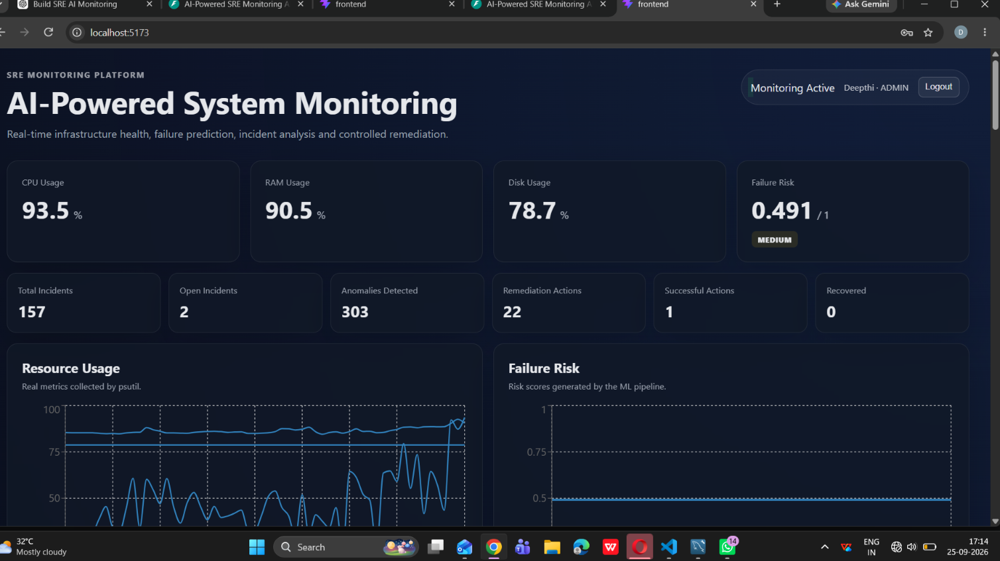
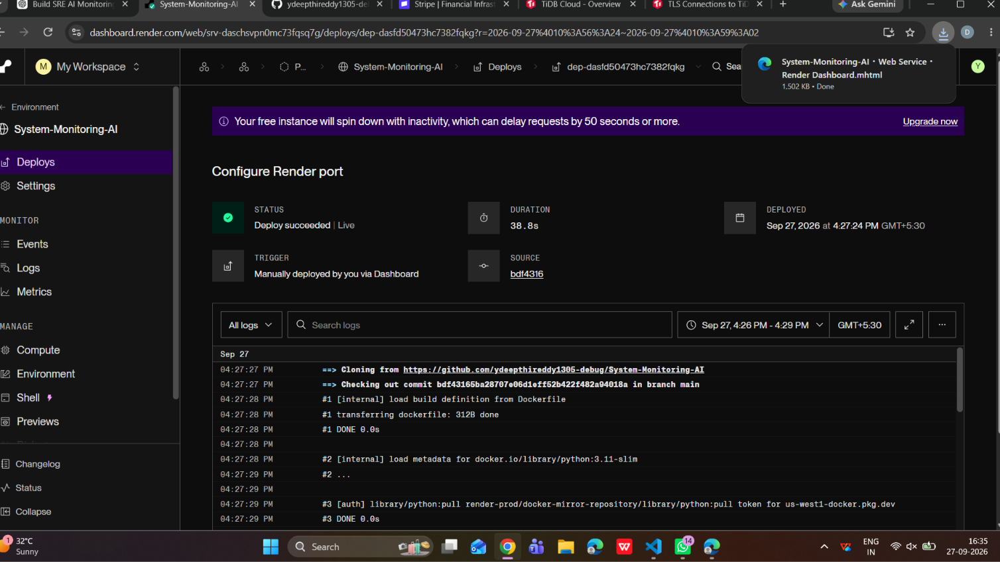
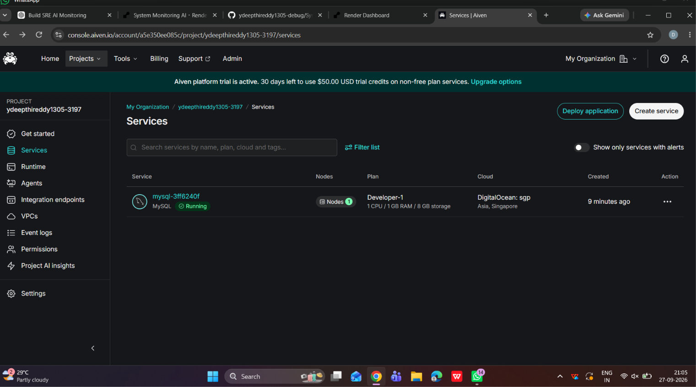

# System Monitoring with AI Predictions

I built this project using Python and React to monitor system resource usage and view alerts in one place. I used FastAPI for the backend and MySQL to store monitoring data. I also worked on adding machine learning and AI-based incident analysis to the monitoring workflow.

## Features

- Collects CPU, RAM, and disk usage using psutil.
- Displays system metrics and resource usage through a React dashboard.
- Detects unusual system activity using a machine learning pipeline.
- Generates failure-risk scores based on monitoring data.
- Uses the Google Gemini API to assist with incident analysis.
- Includes JWT authentication and role-based access control.
- Records remediation actions and checks recovery status.

## Screenshots

### Monitoring Dashboard

The dashboard displays current resource usage, failure risk, incident counts, detected anomalies, and remediation statistics.



### Backend Deployment

The FastAPI backend is deployed as a Docker-based service on Render.




### Database

I used MySQL to store the monitoring data. This screenshot shows the database service configured in Aiven.


## Technologies Used

- Python
- FastAPI
- React
- MySQL
- psutil
- scikit-learn
- NumPy and pandas
- Google Gemini API
- JWT authentication
- Docker
- Render
- Git and GitHub
- pytest

## Run Locally

Clone the repository:

```bash
git clone https://github.com/ydeepthireddy1305-debug/System-Monitoring-AI.git
cd System-Monitoring-AI
```

Create a Python virtual environment:

```bash
py -m venv .venv
.venv\Scripts\Activate.ps1
```

Install the backend dependencies using the requirements file in the appropriate project directory.

Configure the required environment variables for the database connection, JWT secret, and Gemini API key.

Start the FastAPI backend using its configured entry point. Install the frontend dependencies in the frontend directory and start React using the script defined in package.json.

The backend API documentation can be accessed at `/docs` when the local server is running.

## Tests

I used pytest to check the backend functionality. Run the tests from the appropriate project directory:

```bash
python -m pytest -q
```

## Project Links

GitHub: https://github.com/ydeepthireddy1305-debug/System-Monitoring-AI

Live application: https://system-monitoring-ai.onrender.com
